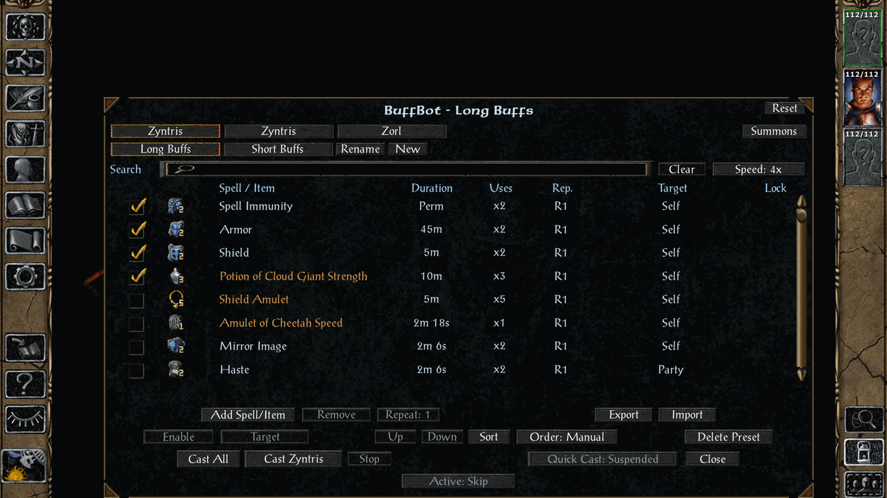
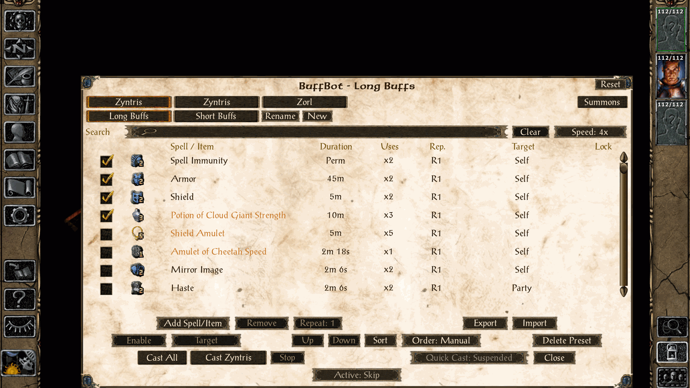

# BuffBot

In-game configurable party buff automation (spells, items, potions, summons, and presets)
for **BG:EE**, **BG2:EE**, **EET**, and **IWD:EE** powered by **EEex**.

**[BuffBot Guide](https://bg.chrizfader.org/buffbot)** · **[Latest Release](https://github.com/Chrizhermann/bg-eeex-buffbot/releases/latest)** · Built into **[Chriz Easy BG](https://bg.chrizfader.org/collection)** & **[Chriz Easy IWD](https://bg.chrizfader.org/iwd)**

> **Requires [EEex](https://github.com/Bubb13/EEex)** v0.11.0-alpha or later with **LuaJIT active** (EEex v1 recommended).

---

## Part 1 — For Players

Cast all your pre-battle buffs with one click. BuffBot scans each character's
spellbook, items, and potions, lets you choose targets, repeat counts, and cast
order, then buffs the entire party in parallel.

[](https://www.youtube.com/watch?v=9fjnUKG1tfQ)

| BG2 Dark Theme | BG1 Light Parchment Theme |
|---|---|
|  |  |

### Features

- **Up to 8 presets per character:** Auto-populated *Long Buffs* and *Short Buffs*
  defaults plus custom presets (create, rename, delete, copy across campaigns via Export/Import).
- **Right-click gear quick-cast:** Right-click the actionbar gear icon to trigger
  any named party preset without opening the panel.
- **Spells, items & potions:** Dynamically scans memorized, innate, HLA, and kit
  spells alongside identified gear powers and backpack potions (optional temporary
  equip-use-restore for backpack items).
- **Summons & clones:** Dedicated **Summons** tab configures Project Images,
  Simulacra, and allied spellcasting summons to run alone or alongside **Cast All**.
- **2x / 4x speed & Quick Cast:** Accelerate single-player prebuffing (`Normal` /
  `2x` / `4x`, automatically stopping on combat or UI popups), or use per-preset
  **Quick Cast** (`Off` / `Long` / `All`) with Improved Alacrity.
- **Smart active-buff handling:** Automatically skips active buffs, refreshes buffs
  about to expire (**Refresh Low**), or forces re-casts (**Force All**).
- **Flexible control & 9 languages:** R1–R5 repeat counts, priority ordering, row
  locks, manual **Add Spell/Item** override, subwindow variant pre-selection,
  experimental [5E Spellcasting](https://github.com/UnearthedArcana/5E_spellcasting)
  support, and 9 UI languages.

### Requirements & WeiDU Installation

- **Supported games:** **BG:EE**, **BG2:EE**, **EET**, and **IWD:EE** (`2.7.3.0` verified).
- **Prerequisite:** **[EEex](https://github.com/Bubb13/EEex)** v0.11.0-alpha+ with
  LuaJIT enabled (on EEex v0.11, install late after biffing; on EET, install after `EET_end`).

1. Download the [latest release](https://github.com/Chrizhermann/bg-eeex-buffbot/releases/latest)
   and extract it into your game directory.
2. Run `setup-buffbot.exe` (or your WeiDU mod manager).
3. Select **BuffBot: EEex LuaJIT Support** (component `1`) first if EEex has not
   already activated LuaJIT.
4. Select **BuffBot: In-Game Buff Automation** (component `0`) once LuaJIT is active.

> **Updating / Project Infinity / Uninstall:** Select both components together in Project
> Infinity (`1` before `0`) and when updating older installs. Uninstall **In-Game Buff
> Automation** first, then **EEex LuaJIT Support** if BuffBot installed it.

### Quick Usage

1. Press **F11** or click the **actionbar button** to open the panel (or **right-click
   the actionbar gear** to cast a preset immediately).
2. Pick a character tab and preset tab, check the buffs/items to cast, set targets
   (`Self`, `Party`, or specific companion), repeats (`R1`–`R5`), and priority order.
3. Choose **Speed** (`Normal` / `2x` / `4x`), **Quick Cast** (`Off` / `Long` / `All`),
   or **Active** mode, then click **Cast** or **Cast All**.

---

## Part 2 — Advanced Usage, Translations & For Developers

### Active Buffs & Refresh Threshold

Configure the global threshold under **EEex options → BuffBot → Refresh buffs that are
nearly over** (off, 1 min, 5 min, 1 hr, or `[BuffBot] RefreshBelow` in `baldur.ini`).
The panel's run-local **Active** button overrides it for one run (`BfBot.Exec.SetForceMode(2)` sets Force All from console):

| Mode | Behavior |
|---|---|
| **Active: Skip** | Default. Skip running buffs unless below the EEex refresh threshold |
| **Active: Refresh Low** | Re-cast running buffs below threshold (defaults to 5 min if option is off) |
| **Active: Force All** | Unconditionally cast every configured buff regardless of remaining time |

### Items, Summons, 5E & IWD:EE Notes

- **Items & potions:** In **EEex options → BuffBot → Inventory item use**, choose *Use
  from inventory* (default) or *Equip, use, and restore* (skips chest armor, unusable
  gear, and duplicate resrefs; scrolls, wands, and containers are not scanned).
- **Summons & Project Image:** Set `SummonsJoinCast = 0` under `[BuffBot]` in
  `baldur.ini` to disable automatic summon casting during **Cast All**. Project Image
  casts are capped at 1 attempt and lock subsequent owner actions in that queue.
- **5E Spellcasting (experimental) & IWD:EE:** Auto-detected when 5E Spellcasting is
  installed before BuffBot (manual-cast variant-selection spells on 5E casters).
  See the [5E tester guide](docs/5e-spellcasting.md) and [validation notes](docs/validation-fork-qol.md).
- **Known limitations:** Charge-based buffs like Stoneskin do not track remaining skins
  for refresh thresholds; Export/Import (`override/bfbot_presets/`) file listing uses
  Windows `dir /b`; some Spell Revisions sub-spells need manual **Add Spell**.

### Presets, Repeat Casts & Bug Reports

- **Presets & repeats:** *Long Buffs* and *Short Buffs* auto-populate on first open
  (newly recruited companions inherit the protagonist's preset names and slots). Repeats
  (`R1`–`R5`) run target-major (`A, A, B, B`); AoEs run N times total.
- **Reporting bugs:** Open an issue on
  [GitHub Issues](https://github.com/Chrizhermann/bg-eeex-buffbot/issues) with your game
  and EEex versions, mod list, reproduction steps, and `BfBot.Test.RunAll()` / `BfBot.FiveE.Diagnose()` logs if relevant.

### Languages & Localization

BuffBot supports **9 languages**: English, Simplified Chinese, Italian, German,
French, Spanish, Polish, Russian, and Brazilian Portuguese. WeiDU copies the selected
UTF-8 catalog to `override/bfbot_l10n.tra` — BuffBot reads directly from that file and
writes nothing to `dialog.tlk` (legacy F12 preset innates are automatically stripped
from older saves on load).

See **[Localization & Translation Guide](docs/localization.md)** for raw-deploy
rules, validation status, and step-by-step contributor instructions for adding a language.

### Console Tests & Developer Setup

Toggle the EEex/CLUA console (`Ctrl-Space`) in-game for built-in diagnostics:

```lua
BfBot.Test.RunAll()         -- full in-game test suite (600+ assertions)
BfBot.Test.ExportImport()   -- export/import tests
BfBot.UI.Toggle()           -- open/close panel (BfBot.FiveE.Diagnose() for 5E)
```

For source development without re-running WeiDU: configure `tools/deploy.conf` with
`BGEE_DIR="/path/to/game"` and run `bash tools/deploy.sh`.

```text
bg-eeex-buffbot/
├── buffbot/    # setup-buffbot.tp2, M_BfBot.lua, BfBot*.lua, BuffBot.menu, lang/, visual/
├── tools/      # build-release.sh, deploy.sh
├── docs/       # Design docs, images, 5E & localization guides
└── tests/      # Offline LuaJIT & WeiDU packaging test suite
```

### Credits

- **[Zach Hopkins](https://github.com/zach-hopkins/bg-eeex-buffbot)** — BuffBot Redux architecture, HUD presets, items, 2x/4x speed, and themed art layer
- **[Pecca](https://www.gibberlings3.net/mods/ui/infinity-ui/)** — Infinity UI++ themed control artwork (used with permission)
- **[EEex](https://github.com/Bubb13/EEex)** (Bubb), **[Bubble Buffs](https://github.com/factubsio/BubbleBuffs)** (factubsio), **[5E Spellcasting](https://github.com/UnearthedArcana/5E_spellcasting)** (subtledoctor), **Endarire**
- Translators & AI tooling: **[robovoid](https://github.com/robvoid)** (Simplified Chinese, [PR #50](https://github.com/Chrizhermann/bg-eeex-buffbot/pull/50)), **[Sauler89](https://github.com/Sauler89)** (Italian), OpenAI Codex, and [Claude Code](https://claude.ai/code)

## License

**[MIT License](LICENSE)** for BuffBot's own code. The themed control artwork under
`buffbot/visual/` is used with permission and is **not** covered by MIT — see
**[ATTRIBUTION.md](ATTRIBUTION.md)** before redistributing it.
